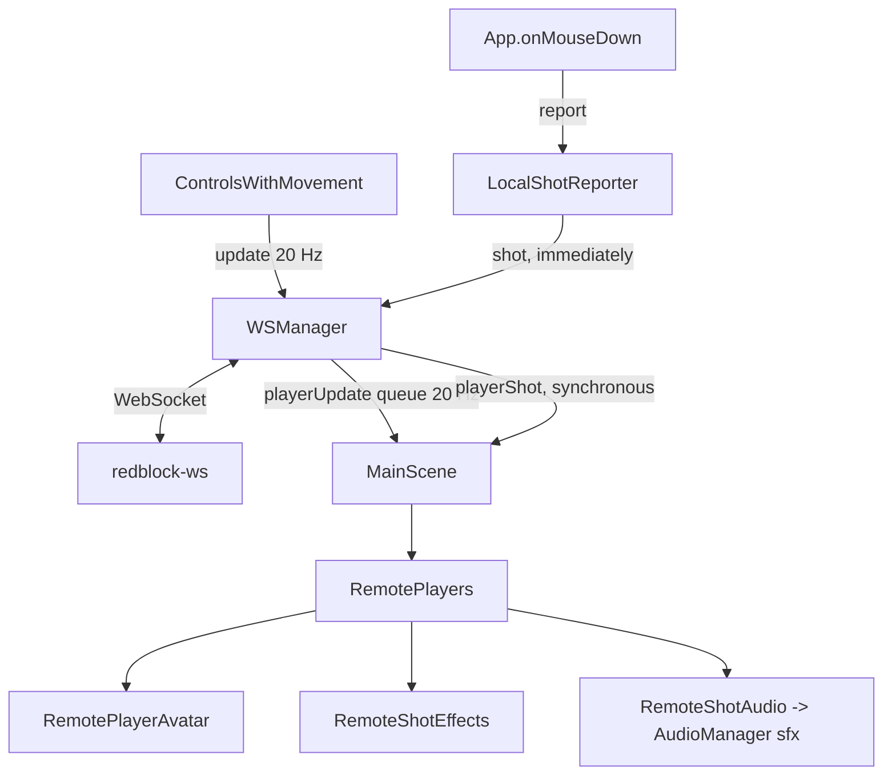

# Networking System

Redblock Online's multiplayer is a thin WebSocket layer: every player trains in their own room, and
neighbours' rooms, avatars, targets and shots are rendered side by side. `WSManager` talks to the
`redblock-ws` server; `MainScene` and the `features/game/multiplayer` module render what arrives.

## Features

- **Room assignment** - the server gives each player an id, a chunk and a room centre (`room_coord_x/z`)
- **Pose sync** - position, yaw/pitch and `targetsInfo` sent at most 20 Hz, only on meaningful change
- **Shot events** - shots are sent the moment the player fires and replayed immediately by neighbours
- **Remote avatars** - low-poly cel-shaded players with head/gun pitch, recoil, muzzle flash, tracer, impact and positional sound
- **Prompt target breaks** - a shot that breaks a target carries its index, so neighbours play the break at once
- **Offline fallback** - after 3 s without a connection the game continues single-player

## Architecture



| File | Role |
|------|------|
| `src/utils/ws/WSManager.ts` | Connection, reconnection, offline fallback, `sendPlayerUpdate`, `sendShot`, `onPlayerShot` |
| `src/features/game/multiplayer/shotProtocol.ts` | Shot message types and frame math (room-local ↔ world, yaw/pitch ↔ direction) |
| `src/features/game/multiplayer/LocalShotReporter.ts` | Builds and sends the local player's shots (client-side 15/s cap) |
| `src/features/game/multiplayer/RemotePlayers.ts` | Avatars per neighbour, shot playback, listener-relative audio |
| `src/features/game/multiplayer/RemotePlayerAvatar.ts` | Low-poly avatar (legs, torso, head + visor, pistol arm) |
| `src/features/game/multiplayer/RemoteShotEffects.ts` | Pooled tracer / muzzle flash / impact meshes |
| `src/features/game/multiplayer/remoteShotAudio.ts` | Distance falloff and stereo pan for remote shots |
| `src/features/game/scenes/MainScene.ts` | Neighbour rooms and targets, wiring of `RemotePlayers` |

## Enabling multiplayer

Multiplayer is off by default (`MULTIPLAYER_ENABLED` in `src/config/gameConfig.ts`). Turn it on at
build/dev time and point the client at a server:

```bash
NEXT_PUBLIC_MULTIPLAYER_ENABLED=true NEXT_PUBLIC_WS_SERVER=ws://localhost:3000 npx next dev -p 3002
```

The editor's play mode always constructs `App` with `disableServer: true`, so it never connects.

## Coordinate frames

- All clients share **one world frame**. The local player spawns at its room centre, so
  `local_player_position_*` and `targetsInfo` are already world positions; neighbours' avatars and
  targets are placed with the raw values. (Editor maps such as Quick Warmup load at absolute
  coordinates and ignore the room offset; avatars and shots still line up because both use the same
  world frame.)
- **Shots travel room-local**: `origin`/`hit` are the world position minus the shooter's room centre.
  The server attaches the shooter's authoritative `room_coord_x/z` to the relayed `playerShot`, and
  the receiver adds them back (`resolveShotWorld`), landing in the same frame as the shooter's avatar.
- **View direction** follows `ControlsWithMovement`: yaw rotates the yaw object about +Y, pitch rotates
  the pitch object about +Z, and yaw = pitch = 0 looks along +X:
  `forward = (cos p · cos y, sin p, −cos p · sin y)`. On the wire `player_rotation_x` is yaw and
  `player_rotation_y` is pitch. A unit test rebuilds the real camera rig to pin this down.

## Message protocol

Client → server:

```typescript
{ type: "update", data: { local_player_position_x, local_player_position_y, local_player_position_z,
                          player_rotation_x /* yaw */, player_rotation_y /* pitch */, targetsInfo } }
{ type: "shot", data: ShotPayload }
{ type: "ping" }

type ShotPayload = {
  origin: [x, y, z];       // camera position, room-local, mm precision
  direction: [x, y, z];    // unit view direction, 4 decimals
  hit?: [x, y, z];         // raycast hit point, room-local
  hitTargetIndex?: number; // index into the shooter's targetsInfo of a target this shot broke
  t?: number;              // sender clock (ms), relayed untouched
};
```

Server → client:

```typescript
{ type: "assigned", id, chunk_number, room_coord_x, room_coord_z }
{ type: "playerUpdate", id, chunk_number, room_coord_x, room_coord_z, local_player_position_*, player_rotation_*, targetsInfo }
{ type: "playerShot", id, room_coord_x, room_coord_z, origin, direction, hit?, hitTargetIndex?, t? }
{ type: "playerLeft", id }
{ type: "pong" }
{ type: "error", message }
```

Server-side shot rules (see the `redblock-ws` README): finite `[x, y, z]` tuples, `|direction| = 1 ± 0.05`
(re-normalised), hit within 150 units in front of the origin and ≤ 0.5 from the ray, origin within 8 units of
the shooter's last reported eye position, `hitTargetIndex` an integer in 0–255, at most 15 shots per second
per player (excess dropped silently). Shots are relayed only to players in the same and adjacent chunks.
Clients that never send `shot` keep working, and older clients ignore `playerShot`.

## Sending shots

`App.onMouseDown` makes one call after its raycast:

```typescript
this.shotReporter.report({
  origin: this._tempCamPos,      // camera world position
  direction: this._tempCamDir,   // camera world direction
  hit: intersects[0],            // first intersection or undefined
  brokeTarget: result === "regular",
  targets: this.targets,
  targetCount: this.currentScenarioTargetCount,
});
```

`LocalShotReporter` does nothing when `wsManager.isOnline()` is false (offline fallback, editor), caps
sending at 15 shots per second, resolves the hit `Target` to its index in `targetsInfo`
(`targetsInfoIndexOf`, same slicing as `buildTargetsInfo`) and, after a break, calls
`controls.requestNetworkSync()` so the new `targetsInfo` goes out on the next 20 Hz tick even if the
player stands still (otherwise `targetsInfo` only travels with movement).

## Receiving shots

`WSManager` dispatches `playerShot` synchronously to `onPlayerShot` listeners (it does not go through the
20 Hz `playerUpdate` queue). `MainScene` forwards it to `RemotePlayers.handleShot`, which:

1. Resolves origin, direction and end point (hit point, or origin + direction × 60) in world space.
2. Snaps the avatar's yaw/pitch to the shot (and its position if it is more than 0.75 off), aims the gun
   pivot exactly at the end point for 0.25 s and starts a 0.14 s recoil.
3. Spawns a muzzle flash at the avatar's muzzle, a tracer from the muzzle to the end point and, on a hit,
   an impact puff.
4. Plays `remote-shot` (the pistol sample under its own name, so its 4-voice cap never cuts local shots) on
   the `sfx` channel. Volume is `0.18 / (1 + d / 12)` before AudioManager applies master and sfx volume;
   pan is the source direction projected on the camera's right vector (× 0.8). `AudioOptions.pan` uses a
   `StereoPannerNode` on the Web Audio path and is ignored by the HTML audio fallback.

If the shot carries `hitTargetIndex`, `MainScene` plays `absorbAndDisappear` on that neighbour target, but
only if it is visible, not already animating and within 1.5 units of the hit point (guards against stale
indices). While the animation runs, `targetsInfo` updates leave that target alone; when it finishes the
latest `targetsInfo` is re-applied, and a target that comes back enabled is reset to full scale/opacity.

## Rendering details

- Avatars share one set of box geometries and three materials (white `MeshToonMaterial`, red accent, dark
  visor/gun); edges come from the renderer's `CustomOutlinePass`.
- `RemoteShotEffects` pools up to 16 meshes per effect kind, each with its own material for opacity; when a
  pool is full the oldest effect is recycled. Animation runs in `update(dt)` without tweens or allocation.
- Effects live in `RemotePlayers.effectsGroup`, which `MainScene.onBeforeRender` hides whenever the scene is
  drawn with an override material. Without this the outline pass draws thin tracers as solid black lines.
- `MainScene.update()` advances avatars and effects every frame (even with no neighbours) and removes a
  neighbour's avatar, room mesh and targets once it disappears from `WSManager.getNeighbors()`.
- `WSManager` drops a departed player's queued `playerUpdate` on `playerLeft`, so they are not re-added as a ghost.

## Testing

```bash
npx vitest run test/utils/WSManager.test.ts test/features/game/multiplayer
```

- `test/utils/WSManager.test.ts` - `sendShot`, synchronous `playerShot` dispatch, malformed/echo filtering, ghost fix
- `test/features/game/multiplayer/shotProtocol.test.ts` - frame math against the real camera rig, cross-room round trip
- `test/features/game/multiplayer/LocalShotReporter.test.ts` - offline no-op, target index, 15/s cap
- `test/features/game/multiplayer/remoteRendering.test.ts` - avatar aim/recoil, pooling, audio falloff/pan, shot playback

For a manual check, run `redblock-ws`, start the client with multiplayer enabled, and drive a second player
from a Node `ws` script that sends `update` and `shot` messages near the browser player's position.

## Troubleshooting

- **No neighbours appear** - multiplayer is disabled (`NEXT_PUBLIC_MULTIPLAYER_ENABLED`), the client fell back
  to offline mode (check the console for `[WSManager]`), or the other player is not in an adjacent chunk.
- **Server replies `Invalid shot: origin far from player`** - the shot origin is more than 8 units from the
  last position the client sent; make sure `update` messages are flowing.
- **Remote tracers are black** - something rendered the scene with an override material without going through
  `MainScene.onBeforeRender`.

## Related

- [App Class](/docs/core-concepts/app) - Firing and raycasting
- [Audio System](/docs/systems/audio) - Channels and volume settings
